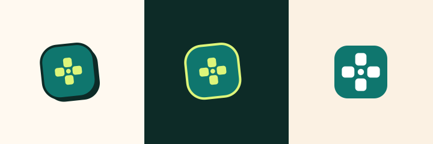
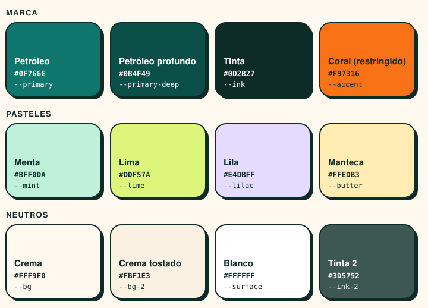
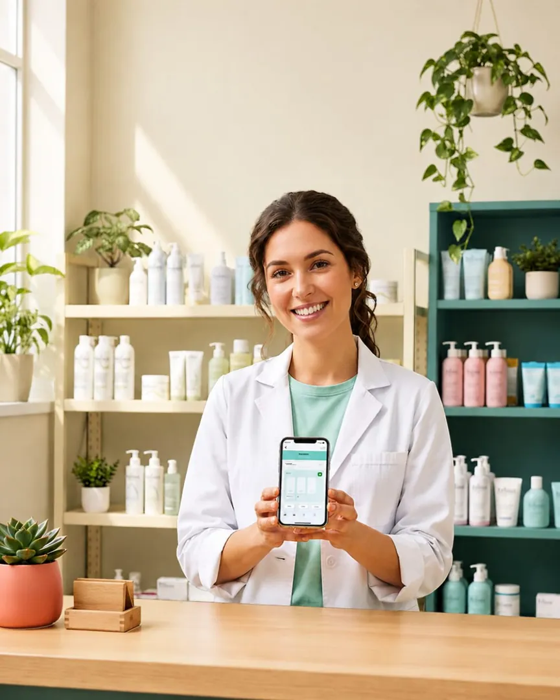
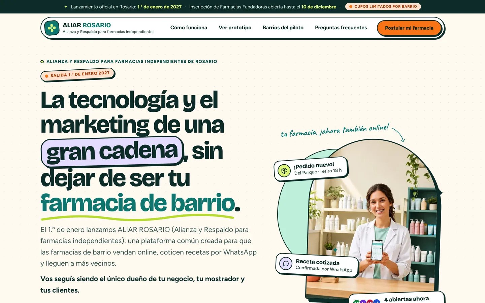
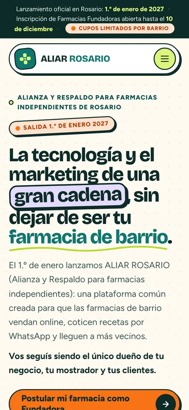
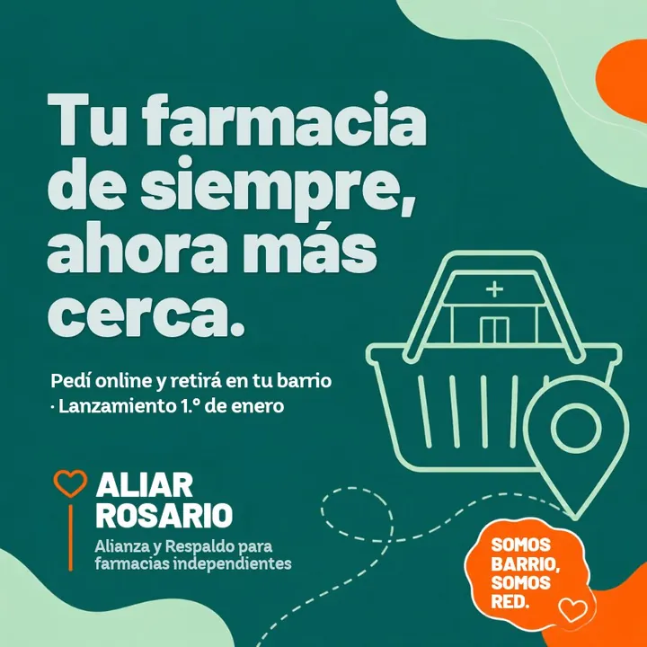
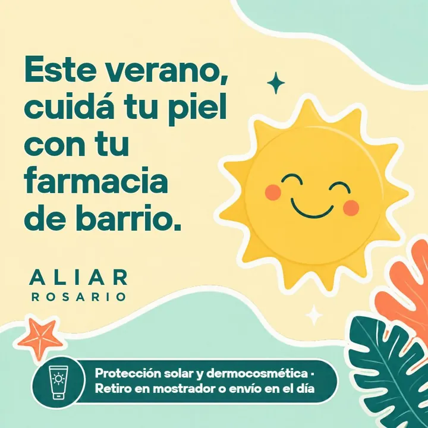
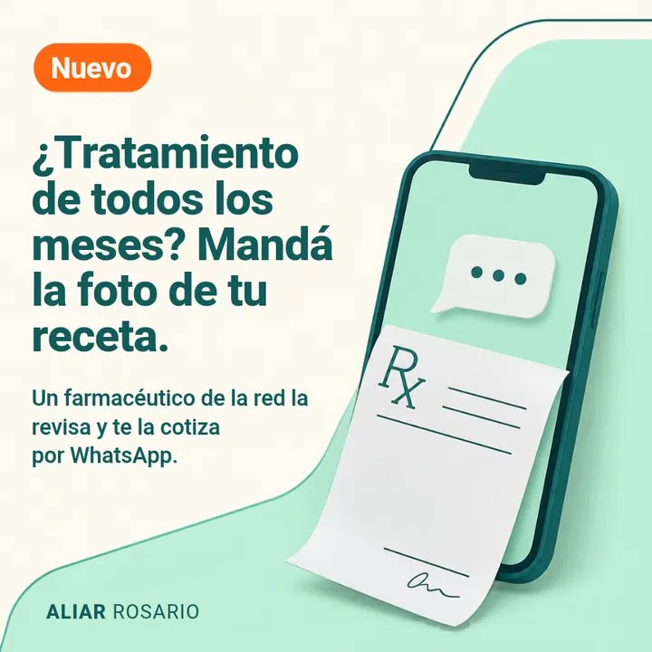

# ALIAR ROSARIO — Guía de estilos

> **Tu farmacia de barrio, con la fuerza de una red.**
> Versión 2.0 · Dirección visual **"Barrio pop"** · 20 de noviembre de 2026

Esta guía reúne las reglas visuales y verbales de ALIAR ROSARIO (Alianza y Respaldo para farmacias independientes). Sirve para que cualquier persona del equipo, de una agencia o de una farmacia de la red pueda producir piezas nuevas sin perder coherencia: la web, las publicaciones en redes, los flyers de mostrador y las presentaciones.

Los valores de esta guía salen del código publicado (`styles.css`), del archivo de Figma y de las piezas de Canva. Si alguna vez no coinciden, manda el código.

---

## Índice

1. [Cómo usar esta guía](#1-cómo-usar-esta-guía)
2. [Marca](#2-marca)
3. [Logotipo](#3-logotipo)
4. [Color](#4-color)
5. [Tipografía](#5-tipografía)
6. [Iconografía](#6-iconografía)
7. [Forma, bordes y sombras](#7-forma-bordes-y-sombras)
8. [Espaciado y retícula](#8-espaciado-y-retícula)
9. [Componentes](#9-componentes)
10. [Fotografía e imágenes](#10-fotografía-e-imágenes)
11. [Movimiento](#11-movimiento)
12. [Voz y tono](#12-voz-y-tono)
13. [Accesibilidad](#13-accesibilidad)
14. [Aplicaciones](#14-aplicaciones)
15. [Tokens para desarrollo](#15-tokens-para-desarrollo)
16. [Checklist antes de publicar](#16-checklist-antes-de-publicar)
17. [Historial de versiones](#17-historial-de-versiones)

---

## 1. Cómo usar esta guía

| Si tenés que… | Andá a… |
|---|---|
| Diseñar una pieza para redes | [Color](#4-color), [Tipografía](#5-tipografía), [Voz y tono](#12-voz-y-tono) y [Aplicaciones](#14-aplicaciones) |
| Sumar una sección a la web | [Componentes](#9-componentes), [Espaciado](#8-espaciado-y-retícula) y [Tokens](#15-tokens-para-desarrollo) |
| Revisar una pieza ajena | [Checklist antes de publicar](#16-checklist-antes-de-publicar) |
| Escribir textos | [Voz y tono](#12-voz-y-tono) |

**Fuentes de verdad, en orden de prioridad**

1. **Código:** `styles.css`, bloque `:root` (sección *1. TOKENS*).
2. **Figma:** archivo [ALIAR ROSARIO — Rediseño juvenil](https://www.figma.com/design/qcYEVeWg9cfx1EbEuslyLQ), página *🎨 Sistema de diseño* (variables, estilos de texto, sombras y componentes).
3. **Canva:** piezas editables de campaña ([Lanzamiento](https://www.canva.com/d/Mzmc8zRmNtY5f16) · [Recetas](https://canva.link/9hiokbvn2emsfw8) · [Verano](https://canva.link/pkwvfy8pye6ryo6)).

**Palabras clave:** *debe* / *nunca* son reglas. *Preferí* / *evitá* son recomendaciones que admiten excepciones justificadas.

---

## 2. Marca

### 2.1 Esencia

| | |
|---|---|
| **Nombre** | ALIAR ROSARIO |
| **Significado** | Alianza y Respaldo para farmacias independientes |
| **Promesa** | Tu farmacia de barrio, con la fuerza de una red. |
| **Qué es** | Una plataforma común para que las farmacias independientes de Rosario vendan online, coticen recetas por WhatsApp y lleguen a más vecinos. |
| **Qué no es** | Una cadena. Cada farmacia sigue siendo dueña de su negocio, su mostrador y sus clientes. |
| **Públicos** | 1) Farmacéuticas y farmacéuticos dueños de farmacias de barrio (B2B, convocatoria de Farmacias Fundadoras). 2) Vecinas y vecinos que compran en esas farmacias (campañas). |
| **Hito** | Lanzamiento piloto: 1.º de enero de 2027. Inscripción de Farmacias Fundadoras hasta el 10 de diciembre. |

### 2.2 Personalidad

| Somos | Sin caer en |
|---|---|
| **Cercanos:** hablamos como el farmacéutico que te conoce por tu nombre. | Confianzudos o chistosos con temas de salud. |
| **Pop y con energía:** colores vivos, stickers, ilustración. | Infantiles o caricaturescos. |
| **Confiables:** profesionales, claros con los números y la normativa. | Fríos, clínicos o burocráticos. |
| **De barrio:** orgullosos de Pichincha, Fisherton, Echesortu… | Nostálgicos o "de antes". |
| **Red:** juntos somos más fuertes. | Corporativos o "de cadena". |

### 2.3 Dirección visual: "Barrio pop"

La versión 2.0 conserva el verde petróleo de la marca y la calidez de la versión 1.0 (*Modernidad Cálida*), pero la lleva a un lenguaje más joven:

- **Fondo crema cálido** en lugar de blanco puro.
- **Pasteles con carácter** (menta, lima, lila y manteca) para separar bloques tipo *bento*.
- **Bordes de tinta de 2 px y sombras sólidas desplazadas**, sin desenfoque: cada tarjeta parece un sticker pegado.
- **Rotaciones leves** (entre −6° y +3°) que le dan un aire hecho a mano.
- **Detalles manuscritos** en Caveat y destellos ✦ como puntuación visual.

---

## 3. Logotipo



### 3.1 Construcción

- **Isotipo:** una cruz de farmacia formada por **cuatro módulos redondeados que no se tocan**, unidos por un **punto central**. Cada módulo es una farmacia; el punto es la red que las une.
- **Geometría** (retícula de 32 × 32): módulos de 8,8 × 9,6 con radio 2,6; punto central de radio 2,4.
- **Contenedor:** cuadrado de esquinas redondeadas (radio ≈ 32 % del lado), relleno **Petróleo `#0F766E`**, borde de **Tinta 2 px** y cruz en **Lima `#DDF57A`**. En la web se gira **−6°**; al pasar el mouse rota a +6° y crece un 5 %.
- **Logotipo:** el contenedor a la izquierda + `ALIAR` en Tinta y `ROSARIO` en Petróleo, en **Bricolage Grotesque ExtraBold (800)**, interletrado −0,01 em. Debajo, opcional, el descriptor *Alianza y Respaldo para farmacias independientes* en Figtree SemiBold 12 px, Tinta 2.

### 3.2 Versiones

| Versión | Contenedor | Cruz | Palabra "ROSARIO" | Uso |
|---|---|---|---|---|
| **Principal** | Petróleo + borde Tinta | Lima | Petróleo | Fondos claros (crema, blanco, pasteles) |
| **Inversa** | Petróleo + borde Lima | Lima | Lima (`ALIAR` en blanco) | Fondos Tinta o Petróleo profundo |
| **Favicon / tamaños chicos** | Petróleo, sin borde ni rotación, radio 25 % | Blanca | — | Íconos de 16 a 32 px, pestaña del navegador, avatar de redes |

### 3.3 Área de respeto y tamaño mínimo

- **Área de respeto:** dejá alrededor del logotipo un margen libre igual a **la mitad del alto del contenedor**.
- **Tamaño mínimo:** contenedor de **32 px** en pantalla y **8 mm** impreso. Por debajo, usá la versión favicon.
- El descriptor se oculta en anchos de pantalla menores a 520 px y entre 1100 y 1299 px, donde no entra junto al menú.

### 3.4 Usos incorrectos

- ❌ Cambiar los colores de la cruz o del contenedor (por ejemplo, cruz coral o contenedor lila).
- ❌ Unir los módulos de la cruz o quitar el punto central.
- ❌ Girar el contenedor más de ±6° o girar el texto.
- ❌ Aplicar degradados, sombras difusas o efectos 3D.
- ❌ Colocar la versión principal sobre fotos sin un fondo sólido detrás.
- ❌ Escribir el nombre en otra tipografía o en minúsculas ("Aliar Rosario").

---

## 4. Color



### 4.1 Paleta

#### Marca

| Nombre | HEX | RGB | Token | Rol |
|---|---|---|---|---|
| **Petróleo** | `#0F766E` | 15, 118, 110 | `--primary` | Color de marca. Enlaces, foco, botón de WhatsApp, palabra "ROSARIO", notas manuscritas. |
| **Petróleo profundo** | `#0B4F49` | 11, 79, 73 | `--primary-deep` | Texto de acento sobre pasteles y fondos oscuros de bloque. |
| **Tinta** | `#0D2B27` | 13, 43, 39 | `--ink` | Texto principal, bordes, sombras, fondos oscuros (barra de anuncio, cinta, pie). |
| **Coral** | `#F97316` | 249, 115, 22 | `--accent` | **Solo** botones principales y señales de urgencia. Ver 4.3. |

#### Pasteles

| Nombre | HEX | RGB | Token | Rol |
|---|---|---|---|---|
| **Menta** | `#BFF0DA` | 191, 240, 218 | `--mint` | Tarjetas, FAQ abierta, mancha del hero, chips de confirmación. |
| **Menta suave** | `#DDF8EB` | 221, 248, 235 | `--mint-soft` | Fondos de apoyo dentro de tarjetas. |
| **Lima** | `#DDF57A` | 221, 245, 122 | `--lime` | Antetítulos, enlace activo del menú, selección de texto, CTA del pie, detalles sobre Tinta. |
| **Lila** | `#E4DBFF` | 228, 219, 255 | `--lilac` | Resaltado "píldora" en titulares, tarjetas, íconos secundarios. |
| **Manteca** | `#FFEDB3` | 255, 237, 179 | `--butter` | Tarjetas y fondo detrás de fotos. |

#### Neutros

| Nombre | HEX | RGB | Token | Rol |
|---|---|---|---|---|
| **Crema** | `#FFF9F0` | 255, 249, 240 | `--bg` | Fondo general de página y de campos de formulario. |
| **Crema tostado** | `#FBF1E3` | 251, 241, 227 | `--bg-2` | Franjas alternas y estados *hover* suaves. |
| **Blanco** | `#FFFFFF` | 255, 255, 255 | `--surface` | Tarjetas, menú, formularios. |
| **Tinta 2** | `#3D5752` | 61, 87, 82 | `--ink-2` | Texto secundario, bajadas, descripciones. |
| **Línea** | `#E8DFD1` | 232, 223, 209 | `--line` | Separadores punteados y divisiones sutiles. |

#### Funcionales y de estado

| Nombre | HEX | Token | Rol |
|---|---|---|---|
| Coral *hover* | `#FB8B3C` | `--accent-hover` | Botón principal al pasar el mouse. |
| Fondo urgencia | `#FFE3D0` | `--urgent-bg` | Fondo de etiquetas de urgencia ("Cupos limitados"). |
| Texto urgencia | `#B4410C` | `--urgent-text` | Texto de etiquetas de urgencia. |
| Error | `#C81E1E` | `--danger` | Bordes, íconos y mensajes de error. |
| Fondo error | `#FFF1F1` | `--danger-soft` | Fondo de campos con error. |
| Lima trazo | `#B6DB2E` | `--lime-ink` | Solo trazos decorativos (el subrayado ondulado del hero). Nunca texto. |
| *Placeholder* | `#5E716C` | — | Texto de ejemplo en campos. |

### 4.2 Proporción de uso

| Grupo | Peso aproximado en una pantalla o pieza |
|---|---|
| Crema y blanco | 55–60 % |
| Tinta y Petróleo (texto, bordes, bloques oscuros) | 25–30 % |
| Pasteles (menta, lima, lila, manteca) | 10–15 % |
| Coral | **3 % o menos** |

- Usá **un pastel por tarjeta**. En grillas, alterná pasteles para que dos tarjetas vecinas nunca repitan color.
- La Lima es el color "con volumen": reservala para lo que tiene que saltar (antetítulos, CTA del pie, ítem activo).

### 4.3 Regla del Coral

El Coral `#F97316` **solo** puede aparecer en:

1. **Botones principales** (`.btn--primary`), con texto en **Tinta** — nunca en blanco.
2. **Señales de urgencia:** el punto pulsante de las etiquetas y la pareja `--urgent-bg` / `--urgent-text` ("Cupos limitados por barrio", "Salida 1.º de enero 2027").

**Nunca** lo uses en titulares, íconos decorativos, fondos de sección, ilustraciones ni como color de texto (contraste 2,68:1 sobre Crema).

### 4.4 Combinaciones accesibles (WCAG 2.2)

Contraste calculado con la fórmula de WCAG. **AA** pide 4,5:1 para texto normal y 3:1 para texto grande (≥ 24 px, o ≥ 18,66 px en negrita).

| Texto | Fondo | Contraste | Resultado |
|---|---|---|---|
| Tinta | Crema | 14,41:1 | ✅ AAA |
| Tinta | Blanco | 15,09:1 | ✅ AAA |
| Tinta | Menta | 11,99:1 | ✅ AAA |
| Tinta | Lima | 12,51:1 | ✅ AAA |
| Tinta | Lila | 11,41:1 | ✅ AAA |
| Tinta | Manteca | 12,94:1 | ✅ AAA |
| Tinta 2 | Crema | 7,48:1 | ✅ AAA |
| Tinta 2 | Menta | 6,22:1 | ✅ AA |
| Petróleo | Crema | 5,23:1 | ✅ AA |
| Petróleo | Blanco | 5,47:1 | ✅ AA |
| Petróleo | Lima | 4,54:1 | ✅ AA (justo) |
| Petróleo profundo | Lila | 7,12:1 | ✅ AAA |
| Petróleo profundo | Menta | 7,49:1 | ✅ AAA |
| Tinta | Coral (botón principal) | 5,38:1 | ✅ AA |
| Blanco | Petróleo (botón WhatsApp) | 5,47:1 | ✅ AA |
| Lima | Tinta | 12,51:1 | ✅ AAA |
| Crema | Tinta | 14,41:1 | ✅ AAA |
| Texto urgencia | Fondo urgencia | 4,63:1 | ✅ AA |
| Error | Fondo error | 5,22:1 | ✅ AA |
| *Placeholder* | Crema | 4,95:1 | ✅ AA |
| Petróleo | Menta | 4,35:1 | ⚠️ Solo texto grande |
| Petróleo | Lila | 4,14:1 | ⚠️ Solo texto grande |
| Blanco | Coral | 2,80:1 | ❌ No usar |
| Coral | Crema | 2,68:1 | ❌ No usar |

> **Regla práctica:** sobre pasteles, el texto va en **Tinta** o **Petróleo profundo**. El Petróleo normal sobre Menta o Lila solo se admite en titulares grandes.

---

## 5. Tipografía

### 5.1 Familias

| Rol | Familia | Pesos | Uso | Respaldo |
|---|---|---|---|---|
| **Display** | [Bricolage Grotesque](https://fonts.google.com/specimen/Bricolage+Grotesque) | 500–800 (eje óptico 12–96) | Titulares, logotipo, números, cinta de barrios, títulos de tarjeta | `ui-sans-serif, system-ui, "Segoe UI", sans-serif` |
| **Texto** | [Figtree](https://fonts.google.com/specimen/Figtree) | 400–800 | Párrafos, botones, etiquetas, formularios, menú | `ui-sans-serif, system-ui, "Segoe UI", sans-serif` |
| **Manuscrita** | [Caveat](https://fonts.google.com/specimen/Caveat) | 600–700 | Notas al margen, flechas comentadas | `"Segoe Print", cursive` |

Las tres son de Google Fonts, con licencia SIL Open Font License (uso comercial libre). Enlace que usa la web:

```html
<link rel="stylesheet" href="https://fonts.googleapis.com/css2?family=Bricolage+Grotesque:opsz,wght@12..96,500..800&family=Caveat:wght@600..700&family=Figtree:wght@400..800&display=swap">
```

### 5.2 Escala tipográfica

Los tamaños fluidos usan `clamp()`: el primer valor es el de celular (375 px) y el segundo, el de escritorio (1440 px).

| Estilo | Familia · peso | Tamaño | Interlineado | Interletrado | Token / clase |
|---|---|---|---|---|---|
| **H1 · Hero** | Bricolage 800 | 40 → 73,6 px | 1,0 | −0,038 em | `--fs-h1` · `.hero__title` |
| **H2 · Sección** | Bricolage 800 | 33,6 → 56 px | 1,05 | −0,03 em | `--fs-h2` |
| **H3 · Tarjeta** | Bricolage 700 | 20 → 24 px | 1,2 | −0,015 em | `--fs-h3` |
| **Frase del pie** | Bricolage 800 | 27 → 45 px | 1,02 | −0,035 em | `.footer__cta-text` |
| **Número de tarjeta** | Bricolage 800, contorno 1,5 px | 41,6 px | 1,0 | −0,04 em | `.card-num` |
| **Bajada (lead)** | Figtree 400 | 18 → 21 px | 1,6 | 0 | `--fs-lead` · `.lead` |
| **Cuerpo** | Figtree 400 | **17 px** (celular) · **18 px** (≥ 1024 px) | 1,6 | 0 | `--fs-body` |
| **Botón** | Figtree 800 | 17 px (chico 15 · grande 18) | 1,2 | 0 | `.btn` |
| **Etiqueta de campo** | Figtree 800 | 16 px | 1,35 | 0 | `.field > label` |
| **Antetítulo** | Figtree 800, MAYÚSCULAS | 13 px | — | +0,08 em | `.eyebrow` |
| **Sticker / tag** | Figtree 800, MAYÚSCULAS | 12,5 px (chico 11,5) | 1,2 | +0,06 em | `.tag` |
| **Nota manuscrita** | Caveat 700 | 25,6 → 33,6 px | 1,1 | 0 | `.hand-note` |

### 5.3 Reglas

- **El texto corrido nunca baja de 16 px.** Los únicos textos más chicos son etiquetas en mayúsculas de una a cinco palabras.
- **Largo de línea:** entre 45 y 62 caracteres (`max-width: 62ch` en bajadas).
- Los titulares usan `text-wrap: balance` y los párrafos `text-wrap: pretty` para evitar viudas.
- Las **MAYÚSCULAS** solo van en antetítulos y stickers, siempre con interletrado positivo.
- **Caveat** es un condimento: máximo una nota por pantalla, de ocho palabras o menos, y nunca para información imprescindible (precios, fechas, requisitos).
- En impresos, el cuerpo mínimo es de **9 pt** y los titulares mantienen el interletrado negativo.
- Para resaltar palabras en titulares hay dos recursos, y como máximo uno de cada uno por titular:
  - **Píldora:** la palabra dentro de una cápsula Lila con borde de Tinta 3 px, sombra de 4 px y giro de −1,5° (ej.: *gran cadena*).
  - **Subrayado ondulado:** la palabra en Petróleo con un trazo ondulado Lima debajo (ej.: *farmacia de barrio*).
- **Número en contorno** (`.card-num`) para pasos y secuencias: solo trazo de 1,5 px, nunca relleno de color.
- **Sello de cierre:** el nombre ALIAR ROSARIO gigante, solo en contorno Lima al 55 %, únicamente en el pie.

### 5.4 Jerarquía en acción

Todo bloque de contenido sigue el mismo orden, de lo que grita a lo que explica:

1. **Antetítulo** — Figtree 800 en mayúsculas, sticker Lima.
2. **Titular** — Bricolage 800, con un único recurso de resaltado.
3. **Bajada** — Figtree 400 en Tinta 2.
4. **Acción** — un solo botón principal.

---

## 6. Iconografía

- **Librería:** [Lucide](https://lucide.dev) 0.469.0 (licencia ISC), cargada desde unpkg con verificación de integridad (SRI).
- **Estilo:** trazo lineal de 2 px, extremos redondeados. Dentro de botones el trazo sube a 2,6 px; en listas de verificación, a 3 px.
- **Tamaños:** 14 px (stickers) · 16–18 px (enlaces y botones) · 22 px (menú y botones de ícono) · 24 px (íconos destacados).
- **Contenedor:** los íconos destacados van dentro de un **círculo de 52 px** (42 px en la versión chica) con borde de Tinta 2 px y fondo Blanco o pastel.
- **Color:** Tinta por defecto; Petróleo en enlaces; Lima sobre fondos oscuros. **Nunca Coral.**
- **Decorativos propios:** el destello ✦ (en Tinta, Petróleo o Lima) y la flecha manuscrita que acompaña a las notas en Caveat.

| Concepto | Ícono Lucide |
|---|---|
| Avanzar / CTA | `arrow-right`, `arrow-up-right` |
| Farmacia | `store` |
| Pedido listo | `package-check` |
| Receta / WhatsApp | `message-circle`, `messages-square` |
| Envío | `truck`, `bike` |
| Ubicación / barrio | `map-pin`, `map`, `locate-fixed` |
| Confianza / normativa | `shield-check`, `badge-check`, `scale`, `landmark` |
| Costo | `badge-percent` |
| Comunidad / red | `users`, `handshake`, `hand-helping` |
| Lanzamiento | `rocket`, `calendar-check`, `calendar-days` |
| Marketing | `megaphone`, `trending-up` |
| Validación | `check`, `circle-check-big`, `clipboard-check` |

---

## 7. Forma, bordes y sombras

### 7.1 Radios

| Token | Valor | Uso |
|---|---|---|
| `--r-sm` | 12 px | Elementos chicos internos |
| — | 14 px | Campos de formulario y alertas |
| `--r` | 20 px | Preguntas frecuentes, tarjetas flotantes, resúmenes |
| `--r-lg` | 28 px | Tarjetas, menú móvil |
| `--r-xl` | 36 px | Bloques grandes (formulario, CTA del pie, demo) |
| `--pill` | 999 px | Botones, stickers, barra de navegación, chips |
| — | 999 999 34 34 px | **Arco** de la foto del hero |

### 7.2 Bordes

- **Estándar:** `2px solid` Tinta (`--b`) en tarjetas, botones, campos, stickers e íconos.
- **Destacado:** 3 px en la foto del hero y en la píldora de los titulares.
- **Separadores:** línea **punteada** de 2 px en color `--line`.

### 7.3 Sombras desplazadas

Todas son **sólidas, sin desenfoque, en Tinta y hacia abajo a la derecha**.

| Token | Valor | Uso |
|---|---|---|
| `--sh-s` | `3px 3px 0` Tinta | Botones, stickers, barra de navegación, tarjetas flotantes |
| `--sh-m` | `5px 5px 0` Tinta | Tarjetas, botón en *hover* |
| `--sh-l` | `8px 8px 0` Tinta | Tarjeta en *hover*, menú móvil, bloques destacados |
| — | `10px 10px 0` Tinta | Foto del hero y tarjeta del formulario |
| — | `8px 8px 0` Petróleo | Excepción: CTA Lima del pie, sobre fondo Tinta |

### 7.4 Rotaciones

| Elemento | Giro |
|---|---|
| Contenedor del isotipo | −6° |
| Stickers inclinados | −3° |
| Antetítulos | −2° |
| Píldora del titular | −1,5° |
| Tarjetas de confianza (escritorio) | −1° / +1° alternado |
| Foto del hero | +2° |
| Cinta de barrios | −1,2° |

Nunca gires bloques con texto largo ni campos de formulario.

---

## 8. Espaciado y retícula

### 8.1 Contenedor y márgenes

| Token | Celular | ≥ 640 px | ≥ 1024 px |
|---|---|---|---|
| `--container` (ancho máximo de contenido) | 1200 px | 1200 px | 1200 px |
| `--gutter` (margen lateral) | 18 px | 24 px | 32 px |
| `--section-y` (aire vertical por sección) | 72 px | 88 px | 112 px |

### 8.2 Escala de espaciado

Preferí múltiplos de 4 px: **4 · 8 · 12 · 16 · 24 · 32 · 48 · 64**. Los saltos intermedios usados en el código (14, 18 y 22 px) se reservan para separaciones internas de componentes.

| Relación | Espacio |
|---|---|
| Ícono ↔ texto | 8 px |
| Elementos dentro de una tarjeta | 12–16 px |
| Tarjetas en una grilla | 18 px (celular) · 22–24 px (escritorio) |
| Encabezado de sección ↔ contenido | 36–60 px |

### 8.3 Puntos de quiebre

| Punto | Qué cambia |
|---|---|
| **< 640 px** | Una columna. Botones a todo el ancho. Menú en botón circular Lima. |
| **640 px** | Grillas de 2 columnas. Aparece el botón "Postular" en la barra. |
| **768 px** | Tabs del prototipo en grilla. Equipo en 2 columnas. |
| **1024 px** | Hero en 2 columnas. Cuerpo a 18 px. Bloques *bento* completos. |
| **1100 px** | Menú horizontal completo. Tarjetas de confianza en 4 columnas, giradas. |

La web es **mobile-first**: el CSS base es el de celular y cada punto de quiebre suma.

### 8.4 Retícula *bento*

Las secciones de beneficios se arman como una grilla *bento*: tarjetas de distinto tamaño (una ancha por cada dos o tres comunes), cada una con su pastel, su ícono en círculo y un título corto. Una tarjeta nunca lleva más de un titular, un párrafo y un elemento de acción.

---

## 9. Componentes

Los componentes de Figma (página *🎨 Sistema de diseño*) tienen el mismo nombre y las mismas variantes que las clases de la web.

### 9.1 Botón — `.btn`

Cápsula con borde de Tinta, sombra de 3 px y, a la derecha, un **círculo con ícono**.

| Variante | Fondo | Texto | Círculo | Cuándo |
|---|---|---|---|---|
| **Principal** `--primary` | Coral | Tinta | Tinta con ícono Crema | La acción más importante. **Uno por pantalla.** |
| **Secundario** `--secondary` | Blanco | Tinta | Lima con borde | Acciones alternativas ("Ver el prototipo") |
| **WhatsApp** `--whatsapp` | Petróleo | Blanco | Lima | Contacto por WhatsApp |

| Tamaño | Alto | Texto |
|---|---|---|
| Chico `--sm` | 46 px | 15 px |
| Mediano | 54 px | 17 px |
| Grande `--lg` | 60 px | 18 px |

**Estados:** *hover* → sube 2 px, sombra de 5 px y el círculo gira −12°. *Active* → baja 2 px y la sombra se reduce a 1 px (efecto "apretado"). *Foco* → anillo Petróleo de 3 px con separación de 3 px. *Enviando* → el ícono se reemplaza por un indicador giratorio y el botón se deshabilita.

**Texto del botón:** verbo + objeto, en primera persona cuando es la decisión del usuario ("Postular mi farmacia", "Ver el prototipo funcionando").

### 9.2 Sticker / etiqueta — `.tag`

Cápsula con borde de 2 px, texto en mayúsculas de 12,5 px.

| Variante | Fondo | Texto | Uso |
|---|---|---|---|
| **Urgencia** `--urgent` | `#FFE3D0` | `#B4410C` + punto Coral pulsante | Plazos y cupos |
| **Menta** `--teal` | Menta | Tinta | Estados positivos ("Abierta ahora") |
| **Sólida** `--solid` | Tinta | Lima | Novedades, destacados |
| **Neutra** `--neutral` | Crema tostado | Tinta 2 | Información secundaria |
| **Inclinada** `--tilt` | (combinable) | — | Giro de −3° y sombra de 3 px para efecto sticker |

### 9.3 Antetítulo — `.eyebrow`

Sticker Lima, girado −2°, con sombra de 3 px. Va encima de cada H2, con tres a cinco palabras que nombran la sección.

### 9.4 Tarjeta — `.card`

Blanco o pastel, borde de 2 px, radio de 28 px, sombra de 5 px y relleno de 22 a 30 px. La versión `--hover` sube 3 px, gira −0,4° y pasa a sombra de 8 px. Las tarjetas de confianza son la misma tarjeta con fondo pastel (Menta, Lila, Manteca, Lima, en ese orden).

### 9.5 Ícono en círculo — `.icon-badge`

Círculo de 52 px (42 px en `--sm`), borde de 2 px, fondo Blanco o pastel, ícono de 24 px en Tinta.

### 9.6 Barra de navegación

Cápsula flotante Blanca al 92 % con desenfoque de fondo, borde de 2 px y sombra de 3 px que pasa a 5 px al hacer *scroll*. El enlace activo se marca con fondo Lima y borde de Tinta. En celular, el menú se abre desde un botón circular Lima de 46 px y se despliega como tarjeta con sombra de 8 px.

### 9.7 Tarjeta flotante — `.float-card`

Notificación ilustrativa sobre la foto del hero ("¡Pedido nuevo!", "Receta cotizada"). Radio de 18 px, ícono en círculo pastel, título en Bricolage 800 y detalle en Figtree 600. Flota suavemente (6 s) con un giro de entre −4° y +3°.

### 9.8 Preguntas frecuentes — `<details>`

Ítem Blanco con borde de 2 px y radio de 20 px. Al abrir: fondo Menta, sombra de 5 px y el "+" gira 135° hasta formar una "×". Se usa el elemento nativo `<details>` para que funcione con teclado y lector de pantalla sin JavaScript.

### 9.9 Formulario

| Estado | Borde | Fondo | Extra |
|---|---|---|---|
| Normal | Tinta 2 px | Crema | Alto mínimo de 56 px, radio de 14 px |
| Foco | Tinta 2 px | Blanco | Sombra Petróleo de 4 px y subida de 2 px |
| Válido | Tinta 2 px | Blanco | Tilde en círculo Lima a la derecha |
| Error | Error `#C81E1E` | `#FFF1F1` | Mensaje en rojo con ícono, debajo del campo |

- La etiqueta va **siempre visible arriba del campo** (Figtree 800, 16 px). Los obligatorios llevan asterisco rojo; los opcionales, "(opcional)" en Tinta 2.
- El error se comunica con **color, ícono y texto**, nunca solo con color.
- La tarjeta del formulario usa radio de 36 px y sombra de 10 px.
- **Pantalla de gracias:** círculo Lima con un tilde que se dibuja, titular de agradecimiento y resumen de los datos enviados en una tarjeta Crema.

### 9.10 Cinta de barrios — `.marquee`

Franja Tinta girada −1,2°, con los barrios del piloto en Bricolage 800 Crema separados por ✦ Lima. Se desplaza en bucle (34 s), se pausa al pasar el mouse y queda quieta si el usuario pidió reducir el movimiento.

### 9.11 Pie de página

Fondo Tinta. Arriba, una tarjeta CTA Lima con sombra Petróleo y giro de −0,8°. Abajo, el nombre **ALIAR ROSARIO** en tamaño gigante, solo contorno Lima al 55 %, como sello de cierre.

---

## 10. Fotografía e imágenes



### 10.1 Dirección

- **Personas reales en farmacias reales de barrio:** mostrador, góndolas, vidriera, la vereda.
- **Luz natural y cálida**, colores que convivan con la paleta (verdes, cremas, maderas).
- **Gestos de atención:** mostrar un pedido en el celular, entregar una bolsa, saludar a un vecino.
- **Evitá:** batas impolutas de banco de imágenes, laboratorios, pastillas en primer plano, fondos azules fríos, sonrisas forzadas a cámara.

### 10.2 Tratamiento

- **Marco en arco** (radio 999 999 34 34 px), borde de Tinta 3 px, sombra sólida de 10 px y giro de +2°.
- Detrás, una **mancha orgánica Menta** con borde de 2 px que cambia de forma lentamente.
- Encima, como máximo **tres tarjetas flotantes** y **una nota manuscrita**.
- Encuadre: `object-position: 50% 30%` para priorizar las caras.

### 10.3 Imágenes generadas con IA

La foto actual del hero se generó con Canva. Para la versión pública, **reemplazala por una foto real** de una farmacia de la red, con autorización firmada de las personas que aparecen. No uses imágenes generadas para representar a farmacéuticos, farmacias o pacientes reales.

### 10.4 Formatos

| Uso | Proporción | Exportación |
|---|---|---|
| Foto del hero | 4:5 | 864 × 1080 px, WebP calidad ~80 |
| Publicación de Instagram | 1:1 | 1080 × 1080 px (diseño) · 720 × 720 px WebP (web) |
| Historia / Reel | 9:16 | 1080 × 1920 px |
| Captura de la web | 16:10 | 1440 × 900 px |

Todas las imágenes de la web llevan `width`, `height` y `alt` descriptivo; las que no están en la primera pantalla, `loading="lazy"`.

---

## 11. Movimiento

### 11.1 Curvas y duraciones

| Token | Valor | Carácter | Uso |
|---|---|---|---|
| `--ease` | `cubic-bezier(0.2, 0.75, 0.25, 1)` | Suave, frena al final | Transiciones de UI, entradas |
| `--spring` | `cubic-bezier(0.34, 1.56, 0.64, 1)` | Rebote leve | Íconos, isotipo, menú, *pop* de éxito |

| Tipo | Duración |
|---|---|
| Respuesta a una acción (*hover*, *active*, foco) | 0,15–0,25 s |
| Abrir o cerrar (menú, FAQ, paneles) | 0,25–0,35 s |
| Entrada de bloques al hacer *scroll* | 0,5–0,9 s |
| Bucles ambientales | 2–34 s |

### 11.2 Catálogo

| Animación | Dónde | Duración |
|---|---|---|
| `float` | Tarjetas flotantes del hero | 6 s, bucle |
| `morph` | Mancha Menta detrás de la foto | 12 s, bucle |
| `twinkle` | Destellos ✦ | 3,2 s, bucle |
| `marquee` | Cinta de barrios | 34 s, bucle |
| `ping` | Punto de urgencia | 2 s, bucle |
| `heroIn` | Entrada de la foto | 0,9 s |
| `faqIn` | Respuesta de FAQ | 0,35 s |
| `errIn` | Mensaje de error | 0,3 s |
| `pop` + `draw` | Tilde de la pantalla de gracias | 0,5 s + 0,7 s |

### 11.3 Reglas

- El movimiento **acompaña**, no decora: cada animación responde a una acción o señala algo vivo (urgencia, red activa).
- Con `prefers-reduced-motion: reduce` todas las animaciones se reducen a un instante y la cinta se detiene.
- Nada parpadea más de tres veces por segundo.

---

## 12. Voz y tono

### 12.1 Principios

1. **Hablamos de vos.** Español rioplatense con voseo: *postulá*, *mandá*, *retirá*.
2. **Claro antes que ingenioso.** Primero qué es, después cómo se siente.
3. **Respeto profesional.** El farmacéutico es el experto; nosotros, la red que lo respalda.
4. **Números concretos.** "0 % costo fijo", "15 minutos", "1.º de enero de 2027".
5. **El vecino en el centro.** "Tu farmacia de siempre, ahora más cerca."

### 12.2 Tono según el público

| Público | Tono | Ejemplo |
|---|---|---|
| **Farmacias (B2B)** | Cercano y profesional, enfocado en el negocio | "Vos seguís siendo el único dueño de tu negocio, tu mostrador y tus clientes." |
| **Vecinos (campañas)** | Cálido, simple, práctico | "Mandá la foto de tu receta y te la cotizamos por WhatsApp." |
| **Urgencia** | Directo, sin alarmismo | "Inscripción abierta hasta el 10 de diciembre." |

### 12.3 Así sí / así no

| ✅ Así sí | ❌ Así no |
|---|---|
| Postular mi farmacia | Enviar formulario |
| Solo pagás cuando concretás una venta | Modelo de *revenue share* basado en conversión |
| Tu farmacia de barrio, con la fuerza de una red | La cadena de farmacias más grande de Rosario |
| Un farmacéutico de la red revisa tu receta | Nuestro algoritmo procesa tu receta |
| Cupos limitados por barrio | ¡¡ÚLTIMOS LUGARES!! ¡No te lo pierdas! |

### 12.4 Vocabulario

| Usar | Evitar |
|---|---|
| Red, alianza, respaldo | Cadena, franquicia, sucursal |
| Farmacia de barrio, farmacia independiente | Punto de venta, local |
| Vecinos, pacientes | Usuarios, *leads*, consumidores |
| Farmacias Fundadoras (con mayúsculas iniciales) | Primeros clientes, *early adopters* |
| Cotizar una receta | Vender medicamentos online |

### 12.5 Formato

- **Fechas:** "1.º de enero de 2027", "10 de diciembre". Nunca "01/01/27".
- **Horas:** "18 h".
- **Teléfonos:** `+54 9 341 XXX-XXXX`.
- **Nombre de marca:** siempre **ALIAR ROSARIO** en mayúsculas. La primera vez que aparece en un texto largo, acompañalo del significado.
- **Signos:** se abren y se cierran (¿…? ¡…!). Como máximo un signo de exclamación por pieza.
- **Emojis:** solo en redes y WhatsApp, uno o dos por mensaje, nunca en la web ni en titulares.

### 12.6 Textos de botones y microtextos

- **Botones:** verbo + objeto. Primera persona cuando la decisión es del usuario («Postular mi farmacia»); segunda cuando invitamos («Escribinos por WhatsApp»).
- **Errores:** qué pasó + cómo resolverlo, sin culpar. «Revisá el número: tiene que tener el código de área.»
- **Confirmaciones:** celebran y dicen qué sigue. «¡Recibimos la postulación de tu farmacia!» + plazo de respuesta.
- **Urgencia:** un dato concreto, sin mayúsculas sostenidas ni signos dobles. «Inscripción abierta hasta el 10 de diciembre.»

### 12.7 Antes y después

| ❌ Antes | ✅ Después |
|---|---|
| «ALIAR ROSARIO es una solución omnicanal que permite a los puntos de venta farmacéuticos optimizar su conversión digital mediante un modelo de comisiones por transacción.» | «Con ALIAR ROSARIO tu farmacia vende online, cotiza recetas por WhatsApp y llega a más vecinos. No pagás abono: solo una comisión cuando concretás una venta.» |

Mismo contenido, otras palabras: sujeto concreto (tu farmacia), verbos de acción y el costo explicado en una frase.

### 12.8 Salud y normativa

- No prometas resultados de salud ni uses superlativos médicos ("el mejor tratamiento", "cura").
- En piezas para el público general no muestres ni promociones medicamentos de venta bajo receta. Toda campaña con productos de salud la valida el referente farmacéutico de la red antes de publicarse.
- Mencioná el encuadre normativo (Santa Fe y ANMAT) cuando hables de recetas, envíos o venta online.

---

## 13. Accesibilidad

Objetivo: **WCAG 2.2 nivel AA** en todas las piezas digitales. La versión 2.0 de la web pasó la verificación de contraste y de nombres accesibles en todos sus estados, sin desplazamiento horizontal de 320 a 1280 px.

| Criterio | Regla ALIAR |
|---|---|
| **Contraste** | Usá solo las combinaciones aprobadas de [4.4](#44-combinaciones-accesibles-wcag-22). |
| **Tamaño de texto** | Cuerpo ≥ 16 px (17–18 px en la web). |
| **Foco visible** | Anillo Petróleo de 3 px con separación de 3 px en todo elemento interactivo. |
| **Áreas táctiles** | Mínimo 44 × 44 px, con 8 px de separación entre controles. Los botones miden entre 46 y 60 px de alto. |
| **Color + forma** | Errores, estados y urgencia nunca dependen solo del color: siempre llevan texto o ícono. |
| **Movimiento** | Respetar `prefers-reduced-motion`. La cinta se pausa al pasar el mouse. |
| **Imágenes** | `alt` que describa la escena o el texto de la pieza. Las decorativas, con `aria-hidden="true"`. |
| **Estructura** | Un único H1 por página, títulos en orden, enlace "Saltar al contenido", formularios con `<label>` asociado. |
| **Idioma** | `lang="es-AR"` en el documento. |
| **Interacción** | Pestañas con roles ARIA, preguntas con `<details>` nativo y menú con `aria-expanded`. |
| **Piezas en redes** | Texto alternativo en cada publicación y el mensaje clave también en el texto del posteo, no solo dentro de la imagen. |

---

## 14. Aplicaciones

### 14.1 Web (landing de convocatoria)





- Sitio estático (HTML + CSS + JS, sin compilación) publicado en GitHub Pages.
- Estructura: anuncio → navegación → hero → cinta de barrios → confianza → problema → prototipo → pilares → barrios → respaldo → equipo → preguntas → postulación → pie.

### 14.2 Redes sociales

| Lanzamiento | Promoción estacional | Recetas por WhatsApp |
|---|---|---|
|  |  |  |
| [Editar en Canva](https://www.canva.com/d/Mzmc8zRmNtY5f16) | [Editar en Canva](https://canva.link/pkwvfy8pye6ryo6) | [Editar en Canva](https://canva.link/9hiokbvn2emsfw8) |

**Plantilla de publicación 1:1**

1. Fondo: un pastel o Crema, con textura de puntos opcional.
2. Titular en Bricolage 800, en Tinta, de 6 a 10 palabras, con una palabra resaltada (píldora o subrayado).
3. Bajada en Figtree, una sola oración.
4. Un sticker (fecha, novedad o urgencia).
5. Logotipo abajo, con su área de respeto.
6. Margen interno mínimo: 80 px sobre 1080 px (en historias, 250 px libres arriba y abajo).

> Las piezas de Canva sumaron por su cuenta dos stickers que no están en los textos aprobados: "Somos barrio, somos red" (lanzamiento) y "Nuevo" (recetas). Revisá si se quedan antes de publicar.

### 14.3 Material de mostrador (recomendación)

- Afiche A3 y flyer A5: Crema de fondo, una tarjeta pastel con el mensaje y un código QR dentro de un sticker Blanco con borde de Tinta.
- Imprimí en CMYK y pedí prueba de color: los pasteles y la Lima tienden a apagarse en papel no estucado.
- Calco de vidriera "Farmacia Fundadora ALIAR ROSARIO" (Ø 15 cm): sticker Lima girado −6° con el isotipo y el texto. Se pega a la altura de los ojos, junto a la puerta.

> Las plantillas del PDF (publicación, historia, flyer y calco) son esquemas de composición, no piezas aprobadas.

---

## 15. Tokens para desarrollo

Copia exacta del bloque `:root` de `styles.css`. Las mismas variables viven en Figma (colección de variables del archivo de diseño).

```css
:root {
  /* Fondos */
  --bg: #FFF9F0;            /* crema */
  --bg-2: #FBF1E3;          /* crema tostado (franjas) */
  --surface: #FFFFFF;
  --mint: #BFF0DA;
  --mint-soft: #DDF8EB;
  --lime: #DDF57A;
  --lime-ink: #B6DB2E;      /* lima para trazos decorativos sobre crema */
  --lilac: #E4DBFF;
  --butter: #FFEDB3;

  /* Tinta y texto */
  --ink: #0D2B27;
  --ink-2: #3D5752;
  --line: #E8DFD1;

  /* Marca */
  --primary: #0F766E;       /* verde petróleo */
  --primary-deep: #0B4F49;
  --accent: #F97316;        /* coral: SOLO botones principales y urgencia */
  --accent-hover: #FB8B3C;
  --urgent-bg: #FFE3D0;
  --urgent-text: #B4410C;

  --danger: #C81E1E;
  --danger-soft: #FFF1F1;

  /* Tipografía */
  --font-display: "Bricolage Grotesque", ui-sans-serif, system-ui, -apple-system, "Segoe UI", sans-serif;
  --font-body: "Figtree", ui-sans-serif, system-ui, -apple-system, "Segoe UI", sans-serif;
  --font-hand: "Caveat", "Segoe Print", cursive;
  --fs-body: 1.0625rem;
  --fs-lead: clamp(1.125rem, 1.05rem + 0.35vw, 1.3125rem);
  --fs-h1: clamp(2.5rem, 1.55rem + 3.9vw, 4.6rem);
  --fs-h2: clamp(2.1rem, 1.45rem + 2.7vw, 3.5rem);
  --fs-h3: clamp(1.25rem, 1.15rem + 0.4vw, 1.5rem);

  /* Formas y sombras desplazadas */
  --r-sm: 12px;
  --r: 20px;
  --r-lg: 28px;
  --r-xl: 36px;
  --pill: 999px;
  --b: 2px solid var(--ink);
  --sh-s: 3px 3px 0 var(--ink);
  --sh-m: 5px 5px 0 var(--ink);
  --sh-l: 8px 8px 0 var(--ink);

  --container: 1200px;
  --gutter: 18px;
  --section-y: 72px;
  --ease: cubic-bezier(0.2, 0.75, 0.25, 1);
  --spring: cubic-bezier(0.34, 1.56, 0.64, 1);
}
@media (min-width: 640px)  { :root { --gutter: 24px; --section-y: 88px; } }
@media (min-width: 1024px) { :root { --gutter: 32px; --section-y: 112px; --fs-body: 1.125rem; } }
```

**Convenciones de código**

- Clases con nomenclatura BEM: `.bloque__elemento--modificador` (ej.: `.btn--primary`, `.float-card__icon--lilac`).
- Ningún color, radio ni sombra se escribe "a mano": siempre a través de un token.
- Los ganchos de JavaScript usan atributos `data-*`, no clases de estilo.

---

## 16. Checklist antes de publicar

**Marca y color**
- [ ] El logotipo respeta área de respeto, tamaño mínimo y versión según el fondo.
- [ ] El Coral aparece solo en el botón principal o en una señal de urgencia.
- [ ] Hay como máximo un botón principal por pantalla o pieza.
- [ ] Todo texto sobre pastel está en Tinta o Petróleo profundo.

**Tipografía**
- [ ] Titulares en Bricolage, texto en Figtree, notas en Caveat (una como máximo).
- [ ] El texto corrido mide 16 px o más.
- [ ] Hay como máximo una palabra resaltada con píldora y una con subrayado por titular.

**Forma**
- [ ] Bordes de 2 px y sombras sólidas en Tinta, hacia abajo a la derecha.
- [ ] Los giros están entre −6° y +3°, y ningún bloque de texto largo está girado.

**Contenido**
- [ ] Voseo y vocabulario de red ("red", "farmacia de barrio", "vecinos").
- [ ] Fechas con formato "1.º de enero de 2027".
- [ ] Sin promesas de salud ni medicamentos de venta bajo receta en piezas al público.
- [ ] La validó el referente farmacéutico (si habla de productos de salud).

**Accesibilidad y técnica**
- [ ] Contraste AA verificado.
- [ ] Imágenes con `alt` y dimensiones; fotos reales y autorizadas.
- [ ] Probado en 320, 768 y 1280 px sin desplazamiento horizontal.
- [ ] Funciona con teclado y con movimiento reducido.

---

## 17. Historial de versiones

| Versión | Fecha | Cambios |
|---|---|---|
| **1.0 · Modernidad Cálida** | 19/11/2026 | Primera landing: tarjetas *bento*, verde petróleo `#0F766E`, Coral restringido, íconos Lucide. |
| **2.0 · Barrio pop** | 20/11/2026 | Nuevas tipografías (Bricolage Grotesque, Figtree, Caveat), fondo Crema, pasteles, bordes de Tinta, sombras desplazadas, stickers, cinta de barrios, foto y piezas de campaña en Canva, sistema de diseño en Figma. |

**Pendientes para la próxima versión**

- Reemplazar la foto generada del hero por una fotografía real autorizada.
- Definir el logotipo definitivo con registro de marca (el isotipo actual es el del prototipo).
- Completar en la web el número de WhatsApp, el correo y los perfiles del equipo.
- Sumar a Figma las pantallas de las secciones que hoy solo están en el código.
